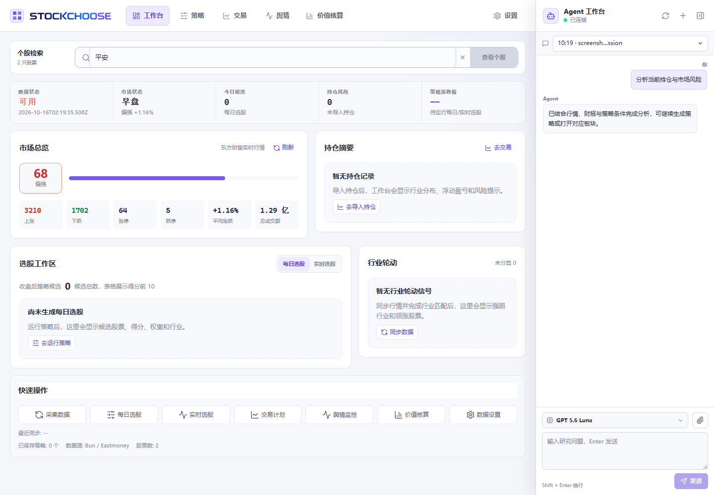
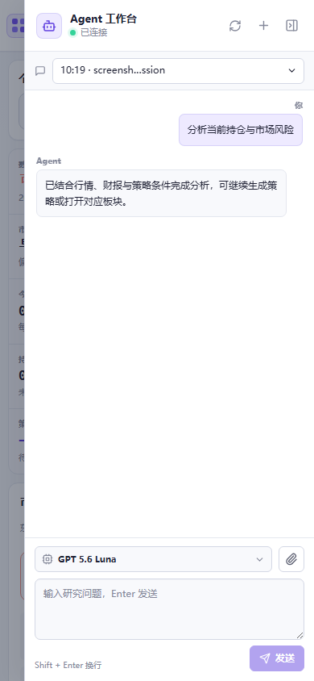
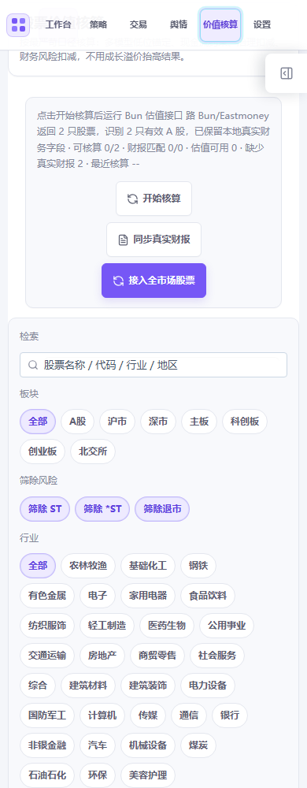

# StockChoose

**本地运行的 A 股研究工作站。**

StockChoose 将市场观察、策略选股、财报阅读、价值核算、舆情分析与交易计划放在同一个桌面工作流中，并提供可收起的右侧 Agent 工作栏。你可以从一只股票、一组筛选条件或一条新闻出发，逐步核查数据、比较候选，再整理下一步研究和操作计划。

项目采用 **Electron + React + TypeScript + Bun**，面向个人研究者、策略学习者，以及希望自行扩展股票研究工具的开发者，以 **MIT License** 开源。

> 当前版本：`0.1.0-beta.1`。项目处于 Beta 阶段，桌面开发与打包以 Windows 为主；行情和新闻需要联网，Agent 需要额外配置。它不是开箱即用的券商自动交易系统。

[界面预览](#界面预览) · [功能概览](#功能概览) · [快速开始](#快速开始) · [能力边界](#能力边界) · [参与贡献](#参与贡献)

## 为什么做这个项目

股票研究经常被拆散在行情软件、筛选表格、财报网页、新闻列表和聊天窗口之间。切换工具之外，更费时间的是确认：这条结论依据什么数据、财报属于哪一期、某个数字是否缺失，以及当前策略为什么选中了这只股票。

StockChoose 尝试把这些步骤串起来：先确认数据状态，再配置筛选条件；从候选进入个股、财报和估值；结合新闻检查风险，最后整理交易计划。项目更关注研究过程是否清楚、结果能否核查，而不是用一条收益曲线代替判断。

它适合用来搭建自己的研究桌面、学习数据采集与策略工具的实现，或作为本地金融应用和 Agent 工具接入的开发起点。

## 界面预览

以下为应用真实界面的归档截图，采集于 **2026-10-16**。截图使用固定测试数据，Agent 的连接状态、模型名称和对话也是模拟响应，用于展示界面与交互布局，**不代表实时行情、实际模型调用或投资结论**。

### 工作台与 Agent

市场总览、持仓摘要、候选工作区和快捷操作集中在首页；右侧 Agent 工作栏可收回展开，切换业务页面时保留会话。


### 个股检索

在工作台通过股票代码或名称查找个股，进入详情查看行情、K 线及相关资料。K 线支持日、周、月周期和复权方式切换。



### 财报详情

财报详情按业绩摘要、利润表、资产负债表和现金流量表组织，展示报告期、披露日期及数据来源。缺失字段保留“未提供”，便于区分未披露与实际为零。


### 窄屏适配

桌面研究是主要使用场景，同时提供移动宽度下的 Agent 抽屉、财报阅读和行业筛选布局。窄屏适配不代表提供原生手机应用。

<table>
  <tr>
    <th>Agent 覆盖抽屉</th>
    <th>财报详情</th>
    <th>行业筛选</th>
  </tr>
  <tr>
    <td valign="top"></td>
    <td valign="top"></td>
    <td valign="top"></td>
  </tr>
</table>

原图尺寸和截图维护规则见 [截图目录](docs/screenshots/README.md)。

## 功能概览

| 模块 | 可以做什么 | 需要注意什么 |
| --- | --- | --- |
| 工作台 | 查看市场涨跌概况、行业轮动、候选股票、持仓摘要与数据同步状态 | 展示内容取决于数据源、同步时间及本地持仓记录 |
| 个股研究 | 按代码或名称搜索，查看历史 K 线、公司资料、公告和年度财报 | 不同来源的字段覆盖和更新时间可能不同 |
| 策略选股 | 配置股票池、筛选条件、评分排序和权重，运行每日或实时选股，进行规则模拟 | 规则模拟不等同于严格的历史行情回测 |
| 价值核算 | 使用行情和财务输入，结合盈利、资产、收入、现金流与行业参数进行多模型核算，查看风险扣减和计算依据 | 缺少必要真实输入时不生成样本估值；参数和假设需要自行核查 |
| 新闻与舆情 | 接入新闻来源，整理事件、方向和关联股票，辅助梳理风险线索 | 新闻关联与情绪判断不代表事实已经证实 |
| 交易计划 | 根据候选权重生成计划，调整并导出指令，管理本地资产记录及模拟交易 | 当前提供本地计划、导出和 paper trade，不代表券商实盘接入 |
| Agent 工作栏 | 管理会话、选择模型、上传研究文件，携带页面与股票上下文发送消息，接收工作区操作请求 | 依赖独立部署的官方 DSH 运行时及模型服务 |
| 数据设置 | 配置和检测数据源，查看采集、缓存与调度状态 | 外部接口可能限流、失效或返回不完整数据 |

### 一次典型的研究流程

1. **检查数据。** 在工作台或设置中查看数据源、同步时间和股票池，先确认当前数据可用。
2. **配置策略。** 选择研究范围、筛选条件、评分与权重，运行选股并检查候选结果。
3. **核查个股。** 从候选进入行情、公告和财报，确认报告期、关键字段与缺失项。
4. **比较估值。** 同步必要财报后手动开始核算，检查模型参数、现金流约束和风险折价。
5. **补充风险线索。** 结合新闻、舆情或可选 Agent 整理待验证问题，再决定是否形成交易计划。

## 快速开始

### 环境准备

建议使用 **Node.js 24、npm 和 Bun 1.3**。启动前确认 `node`、`npm`、`bun` 均可在终端中调用。

当前桌面打包脚本面向 **Windows x64**。其他系统可自行尝试源码运行，但本仓库没有承诺已完成对应安装包和兼容性验证。

### 启动桌面应用

```powershell
git clone https://github.com/FINOHSIANG/Stockchoose.git
cd Stockchoose
npm ci
npm run dev
```

`npm run dev` 启动 Vite 与 Electron。数据请求通过本地代理转交 Bun 服务，代理按需启动 sidecar。首次安装需要下载依赖及 Electron。

### 仅预览网页

```powershell
npm run dev:web
```

默认打开 `http://127.0.0.1:5173/`；若端口占用，以终端实际输出为准。请保留开发服务运行：网页仍依赖 Vite 的本地 API 代理，不能把 `dist/` 静态托管当作完整的桌面应用部署。

### 可选数据源与 Agent

| 配置 | 用途 | 是否必需 |
| --- | --- | --- |
| `STOCKCHOOSE_AKTOOLS_BASE_URL` | 指向自行部署的 AKTools 服务 | 仅在使用该外部服务时需要 |
| `STOCKCHOOSE_DSH_START_URL` | 将 Bun 网关连接到本机官方 DSH 启动地址 | 仅使用 Agent 时需要 |
| `STOCKCHOOSE_AGENT_AUTH_FILE` | 本地 sidecar 认证文件位置 | 由启动脚本生成或通过本地配置指定 |

环境变量应设置在启动进程的终端中；不要把真实 token、API Key 或带认证参数的地址写入仓库。

**Agent 不随应用自动安装。** 需要独立准备官方 DSH 及其运行环境、模型服务和本机 profile，并在启动应用前提供连接配置。不使用 Agent 时无需配置模型密钥，工作栏会显示未配置状态。

[DSH 接入说明](docs/agent-dsh-backend-integration-2026-09-25.md) 记录了接口、环境变量与阶段性联调流程。其中 `agent/stockchoose-dsh-profile.yml` 是本地配置路径，克隆仓库后不会自带该文件；文档中的阶段性待办也不应视为当前功能清单。

## 技术结构

```text
React / TypeScript 界面
          |
Electron 桌面代理 / Vite 开发代理
          |
Bun 本地 API
          |-- 行情、财报、公告、新闻采集与缓存
          |-- 策略、估值、舆情及交易计划服务
          `-- Agent 网关 --> 官方 DSH 运行时 --> 模型服务 / MCP
```

| 目录 | 内容 |
| --- | --- |
| `src/` | React 界面、领域逻辑、前端服务与单元测试 |
| `src/agent/` | 右侧工作栏、会话状态与 Agent 客户端 |
| `bun-api/` | 本地 API、采集、调度、缓存和业务服务 |
| `bun-api/agent/` | DSH 网关与工作区操作接口 |
| `electron/` | 桌面主进程、preload 与 sidecar 代理 |
| `scripts/` | 启动、打包、联调检查与 MCP 工具 |
| `tests/` | Playwright 浏览器流程和固定测试数据 |
| `docs/` | 架构、接入说明、审计记录与界面截图 |
| `archive/rust-legacy/` | 历史 Rust 实现，不参与默认运行和构建 |

架构背景见 [Electron + Bun 迁移说明](docs/architecture/electron-bun-migration.md)。研究配置和缓存保存在本机，但行情采集、新闻请求及外部模型调用仍会访问网络；“本地运行”不等于“完全离线”或“数据从不离开设备”。

## 测试与构建

| 命令 | 用途 |
| --- | --- |
| `npm run test:unit` | 前端服务和领域逻辑单元测试 |
| `npm run test:agent` | Agent 网关与 MCP 客户端测试 |
| `npm run test:backend` | 出站请求安全与 Electron 代理测试 |
| `npm run test:smoke` | Playwright 浏览器交互测试 |
| `npm test` | 依次运行上述测试 |
| `npm run build:beta` | 单元、Agent、后端检查，Bun 编译检查及生产构建 |
| `npm run bun:live-smoke` | 真实数据源联调检查，需要网络及相应服务可用 |
| `npm run package:beta` | 构建 Windows x64 便携版，不会自动上传或发布 |

首次运行浏览器测试前安装 Chromium：

```powershell
npx playwright install chromium
npm run test:smoke
```

Windows 打包：

```powershell
npm run package:beta
```

构建产物位于 `release/beta/`。固定测试数据用于让自动化测试可重复，测试通过不代表全部外部行情源、实际模型服务或券商交易链路已验证。

## 能力边界

- **行情不是保证可用的服务。** 数据源可能延迟、限流或变更接口；使用前检查来源、时间戳、单位和字段覆盖。
- **规则模拟不是历史业绩。** 当前模拟用于观察规则和参数行为，不应据此宣称策略已通过完整历史回测或预测未来收益；自定义择时公式目前也不独立解析执行。
- **估值不是目标价承诺。** 输出受财务口径、行业参数和风险折价影响，缺失财报不能靠行情反推补齐。
- **交易界面不是券商连接。** 本地计划、指令导出、资产记录和模拟成交，不构成真实委托或券商账户同步。
- **Agent 不是内置投顾。** 它依赖外部运行时，可能产生错误结论；发送文件前应检查内容，执行工作区操作前应核对请求。
- **仓库开源不等于数据授权。** 第三方行情、财报、新闻、模型服务及品牌素材仍受各自条款约束。

## 参与贡献

欢迎通过 [Issue](https://github.com/FINOHSIANG/Stockchoose/issues) 反馈问题，或通过 Pull Request 提交改进。数据源适配、财务字段映射、规则模拟的真实性、错误恢复、跨平台运行和自动化测试，都是有价值的贡献方向。

提交问题时请提供系统和运行版本、复现步骤、预期与实际表现，以及脱敏后的错误信息。涉及数据问题时，请补充来源、时间、单位和字段名称；不要只附一个最终数值。

提交代码时请保持现有结构和接口约定，补充相关测试，并说明验证范围。界面改动请附桌面和窄屏截图。`tmp/`、`data-cache/`、本地 profile、认证文件、运行日志及个人持仓不应提交。

## 许可证

项目代码以 [MIT License](LICENSE) 开源。第三方依赖遵循各自许可证；本项目的开源许可不授予第三方数据、服务或品牌的额外使用权。

**免责声明：** 本项目用于研究、学习与工具开发，不构成投资建议。项目不保证数据准确性、模型结论、策略收益或交易结果；任何实盘决策都应经过独立核实，并由使用者自行承担风险。
