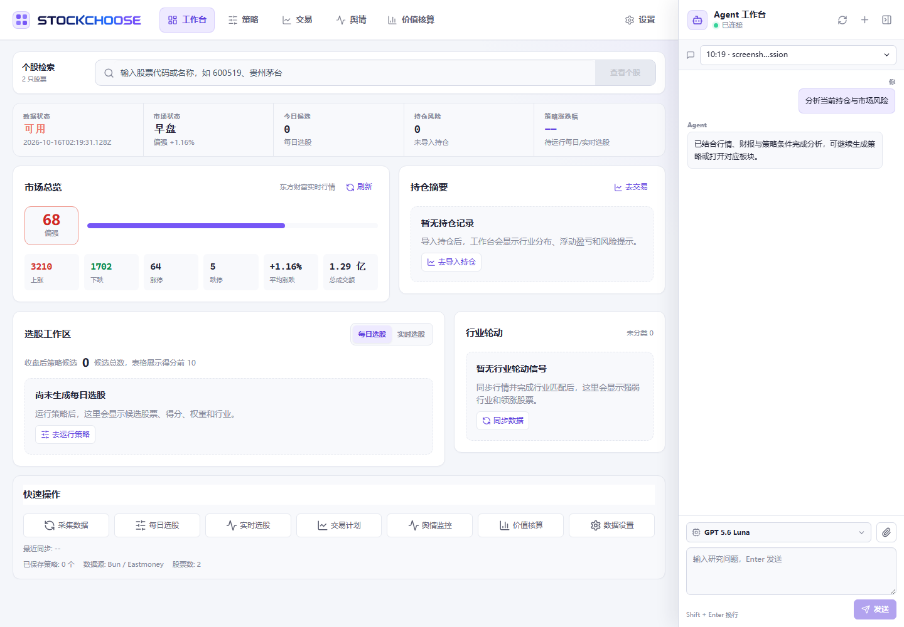
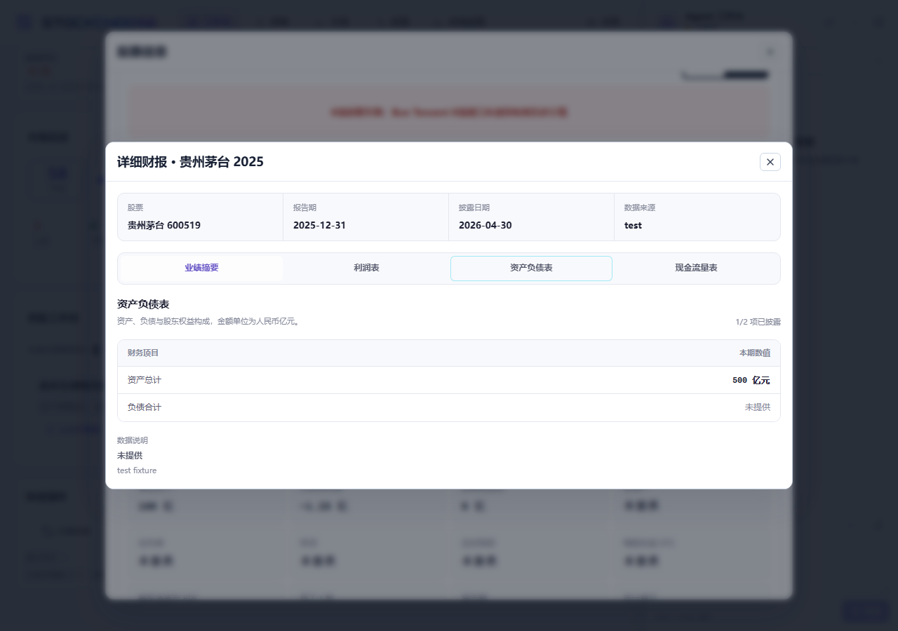
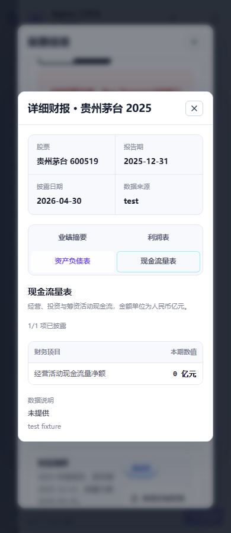

# StockChoose

**Agent 驱动的 A 股多频道研究与调度工作站。**

StockChoose 以 **Agent 为统一研究入口**，将行情、策略、交易计划、舆情、价值核算与数据设置组织为可跨频道衔接的业务工作区。你可以用自然语言提出研究目标，让 Agent 查询行情、财报和公告，创建股票池、策略或自定义因子，再打开相应频道继续处理。

**从对话到工具调用，再到工作区中的实际结果。** Agent 不只生成文字，还能通过 MCP 调用本地数据服务，将已支持的操作写入界面并接收执行回执。右侧工作栏贯穿各业务频道，切换页面无需重新开始会话。

**核心演进方向：调度 Agent 随新数据更新策略，串联测试、回测与结果比较，形成持续迭代的研究流程。** 当前已具备数据查询、策略资源创建，以及界面中的选股与规则模拟；Agent 更新已有策略、直接调度测试，以及基于逐日历史行情的回测仍待接入。详见 [Agent 策略迭代](#agent-策略迭代)。

项目采用 **Electron + React + TypeScript + Bun**，面向个人研究者、策略学习者，以及希望自行扩展股票研究工具的开发者，以 **MIT License** 开源。

> 当前版本：`0.1.0-beta.1`。项目处于 Beta 阶段，桌面开发与打包以 Windows 为主；行情和新闻需要联网，Agent 需要额外配置。它不是开箱即用的券商自动交易系统。

[Agent 策略迭代](#agent-策略迭代) · [Agent 多频道调度](#agent-多频道调度) · [界面预览](#界面预览) · [快速开始](#快速开始) · [能力边界](#能力边界) · [支持与捐赠](#支持与捐赠)

## 为什么做这个项目

股票研究经常被拆散在行情软件、筛选表格、财报网页、新闻列表和聊天窗口之间。切换工具之外，更费时间的是确认：这条结论依据什么数据、财报属于哪一期、某个数字是否缺失，以及当前策略为什么选中了这只股票。

StockChoose 让 Agent 在这些步骤之间承担调度角色：按问题调用数据工具，把研究对象整理成股票池，将策略和因子保存到工作区，再带着同一段会话进入后续频道。人工可以随时在界面核查数据、修改配置或继续操作，而不必把对话结论重新录入另一套工具。

它适合用来搭建自己的 Agent 研究桌面、扩展面向金融业务的 MCP 工具，或学习自然语言指令如何连接本地数据与可操作的界面。

## Agent 策略迭代

### 让研究从一次选股走向持续验证

策略研究不止于生成一组条件。行情变化、财报披露或新的风险事件，都可能要求重新检查股票池、因子和权重，再测试改动是否符合预期。

StockChoose 的核心演进目标，是让用户可以**调度 Agent，根据新数据及时提出策略修改，运行测试与回测，比较调整前后的结果，再确认是否采用**。这里的“实时更新”指面向新数据及时迭代的产品方向，不代表当前已经具备无人值守的行情事件触发、自动改策略或低延迟执行服务。

```text
目标研究流程（尚未全链路接通）

新行情 / 新财报 / 用户的新要求
                |
        Agent 读取数据与策略上下文
                |
        提出策略修改并展示差异
                |
        用户确认更新已有策略
                |
        运行规则测试与历史回测
                |
        比较候选变化、风险与结果
                |
        接受修改，或继续迭代
```

### 当前能力与待接入项

| 研究环节 | 当前可用 | 仍需补齐 |
| --- | --- | --- |
| 数据驱动研究 | Agent 可调用行情、公司资料、财报和公告工具 | 自动订阅数据事件并触发策略迭代 |
| 创建策略资源 | Agent 可创建策略、股票池、自定义因子并获得工作区回执 | 更新已有策略的条件、权重与参数，展示修改差异及版本记录 |
| 测试策略规则 | 策略页面及 Bun API 提供选股、排序和参数优化能力 | 将策略检查、试运行与结果读取注册为 Agent 工具 |
| 模拟与回测 | 界面提供基于当前快照的规则模拟，接口保留 `backtest` 命名 | Agent 调度入口，以及基于逐日历史行情的回测引擎与结果验证 |
| 形成迭代闭环 | 会话可跨频道持续，已支持的工作区操作会返回执行回执 | 将策略更新、测试、回测和调整前后比较串联为完整任务 |

**当前规则模拟不是历史回测。** 它使用当前股票快照、因子分数和确定性规则生成结果，不读取逐日历史成交价格。模拟收益、回撤或参数优化结果不能当作真实历史业绩；接口名称也不改变这一边界。

“测试”在这一研究流程中指策略条件检查、试运行和结果核查，不是自动执行本仓库的单元测试。当前两类测试都没有对应的内置 Agent 调度工具。

### 希望支持的任务表达

> **目标交互，尚不能由当前内置 MCP 全自动完成：** “根据最新财报检查我的成长策略，提出因子权重修改，列出变更差异；我确认后更新策略，运行规则测试和历史回测，再比较修改前后的候选、回撤与换手情况。”

现阶段可由 Agent 完成数据查询和资源创建，用户再到策略频道编辑配置、运行选股与规则模拟。尚不能将上述完整请求表述为已经交付的自动化能力。

## Agent 多频道调度

### 一个 Agent 入口，贯穿六个业务频道

这里的“频道”指应用内的业务工作区。Agent 可切换工作台、策略、交易、舆情、价值核算和设置，并在同一会话中组合已有工具；**各频道可导航，不意味着各频道所有按钮都已开放为 Agent 工具**。

| 业务频道 | 当前 Agent 可调度的能力 |
| --- | --- |
| 行情工作台 | 读取市场概览、个股行情、公司资料，检查数据同步状态，打开工作台 |
| 策略频道 | 创建并保存策略配置、静态股票池和自定义因子，打开页面供用户编辑、选股与规则模拟；已有策略更新和测试、回测调度工具待接入 |
| 交易频道 | 打开交易工作区，供用户继续核对计划和导出指令；尚无内置实盘下单 MCP 工具 |
| 舆情频道 | 打开舆情工作区；公告可通过独立读取工具获取，新闻采集与舆情分析尚未注册为内置 MCP 工具 |
| 价值核算频道 | 查询财务报表并打开核算页面；开始核算仍由用户在界面操作 |
| 数据设置频道 | 查询同步与数据源状态，打开设置页面继续检查和配置 |

### 调度如何形成闭环

```text
用户提出研究目标
       |
Agent 会话：结合当前页面、股票与策略上下文
       |
官方 DSH 运行时 + StockChoose MCP 工具
       |-- 读取：同步状态 / 市场 / 行情 / 公司资料 / 财报 / 公告
       `-- 操作：创建策略 / 创建股票池 / 创建因子 / 切换频道
                       |
              Bun 工作区操作队列
                       |
              界面执行、保存并回传结果
                       |
              Agent 获得执行回执
```

创建类操作返回策略、股票池或因子的标识及结果，便于后续调用衔接。工作区操作区分等待、认领、完成和失败状态；MCP 工具只有收到工作区完成回执才将操作报告为成功，不把“已发出请求”当作“已完成”。

多标签页场景会将操作交给发起消息的工作区处理，避免同一请求被其他标签页抢先执行。它不是多 Agent 并行调度系统，也不提供无人值守的跨频道任务编排承诺。

### 可以怎样向 Agent 下达任务

完成 DSH 与 MCP 接入后，可以按以下方式提出任务；模型需要调用相应工具，具体结果以数据返回和操作回执为准。

> “查询贵州茅台的行情、财务报表和最近公告，整理还需要人工核实的风险项。”

> “把 600519 和 000858 建成一个名为‘白酒观察’的股票池，再用返回的股票池 ID 创建‘白酒研究’策略，打开策略频道让我检查配置。”

> “新增一个名为‘成长质量’的自定义因子，公式是 `revenueGrowth * 0.6 + roe * 0.4`，然后打开价值核算频道。”

创建策略当前使用默认策略模板；上述操作不代表 Agent 已自动配置全部筛选条件、运行选股或执行估值。用户可以在对应频道检查并继续完成这些步骤。

### 内置 MCP 工具

| 类型 | 工具 |
| --- | --- |
| 数据读取 | `stockchoose_sync_status`、`stockchoose_market_overview`、`stockchoose_market_quotes`、`stockchoose_stock_profile`、`stockchoose_finance_statements`、`stockchoose_filing_announcements` |
| 工作区操作 | `stockchoose_create_strategy`、`stockchoose_create_stock_pool`、`stockchoose_create_custom_factor`、`stockchoose_open_section` |

工具实现见 [`scripts/stockchoose-agent-mcp.mjs`](scripts/stockchoose-agent-mcp.mjs)。开发者可以沿用现有网关与操作回执协议扩展更多频道能力，无需另建一套聊天界面。

## 界面预览

以下为应用真实界面的归档截图，采集于 **2026-10-16**。截图使用固定测试数据，Agent 的连接状态、模型名称和对话也是模拟响应，用于展示界面与交互布局，**不代表实时行情、实际模型调用或投资结论**。

### Agent 调度入口与工作台

右侧 Agent 是贯穿频道的统一入口，可管理会话、切换模型、上传研究文件并发送携带业务上下文的任务。左侧保留市场总览、持仓摘要和选股工作区，便于对照工具结果继续操作。



### 个股检索

在工作台通过股票代码或名称查找个股，进入详情查看行情、K 线及相关资料。K 线支持日、周、月周期和复权方式切换。


### 财报详情

财报详情按业绩摘要、利润表、资产负债表和现金流量表组织，展示报告期、披露日期及数据来源。缺失字段保留“未提供”，便于区分未披露与实际为零。



### 窄屏适配

桌面研究是主要使用场景，同时提供移动宽度下的 Agent 抽屉、财报阅读和行业筛选布局。窄屏适配不代表提供原生手机应用。

<table>
  <tr>
    <th>Agent 覆盖抽屉</th>
    <th>财报详情</th>
    <th>行业筛选</th>
  </tr>
  <tr>
    <td valign="top"></td>
    <td valign="top"></td>
    <td valign="top"></td>
  </tr>
</table>

原图尺寸和截图维护规则见 [截图目录](docs/screenshots/README.md)。

## 功能概览

| 模块 | 可以做什么 | 需要注意什么 |
| --- | --- | --- |
| Agent 多频道调度 | 在统一会话中调用数据工具，创建策略、股票池和因子，切换六个业务频道并接收操作回执 | 依赖官方 DSH 与 MCP 接入；频道可导航不等于全部业务已自动化 |
| Agent 策略迭代方向 | 以新数据驱动策略调整，目标串联更新、测试、回测与结果比较 | 当前仅部分基础能力可用，不是已交付的全自动策略更新链路 |
| 工作台 | 查看市场涨跌概况、行业轮动、候选股票、持仓摘要与数据同步状态 | 展示内容取决于数据源、同步时间及本地持仓记录 |
| 个股研究 | 按代码或名称搜索，查看历史 K 线、公司资料、公告和年度财报 | 不同来源的字段覆盖和更新时间可能不同 |
| 策略选股 | 配置股票池、筛选条件、评分排序和权重，运行每日或实时选股，进行规则模拟 | 规则模拟不等同于严格的历史行情回测 |
| 价值核算 | 使用行情和财务输入，结合盈利、资产、收入、现金流与行业参数进行多模型核算，查看风险扣减和计算依据 | 缺少必要真实输入时不生成样本估值；参数和假设需要自行核查 |
| 新闻与舆情 | 接入新闻来源，整理事件、方向和关联股票，辅助梳理风险线索 | 新闻关联与情绪判断不代表事实已经证实 |
| 交易计划 | 根据候选权重生成计划，调整并导出指令，管理本地资产记录及模拟交易 | 当前提供本地计划、导出和 paper trade，不代表券商实盘接入 |
| 数据设置 | 配置和检测数据源，查看采集、缓存与调度状态 | 外部接口可能限流、失效或返回不完整数据 |

### 一次典型的研究流程

1. **检查数据。** 在工作台或设置中查看数据源、同步时间和股票池，先确认当前数据可用。
2. **配置策略。** 选择研究范围、筛选条件、评分与权重，运行选股并检查候选结果。
3. **核查个股。** 从候选进入行情、公告和财报，确认报告期、关键字段与缺失项。
4. **比较估值。** 同步必要财报后手动开始核算，检查模型参数、现金流约束和风险折价。
5. **补充风险线索。** 结合新闻、舆情或可选 Agent 整理待验证问题，再决定是否形成交易计划。

## 快速开始

### 环境准备

建议使用 **Node.js 24、npm 和 Bun 1.3**。启动前确认 `node`、`npm`、`bun` 均可在终端中调用。

当前桌面打包脚本面向 **Windows x64**。其他系统可自行尝试源码运行，但本仓库没有承诺已完成对应安装包和兼容性验证。

### 启动桌面应用

```powershell
git clone https://github.com/FINOHSIANG/Stockchoose.git
cd Stockchoose
npm ci
npm run dev
```

`npm run dev` 启动 Vite 与 Electron。数据请求通过本地代理转交 Bun 服务，代理按需启动 sidecar。首次安装需要下载依赖及 Electron。

### 仅预览网页

```powershell
npm run dev:web
```

默认打开 `http://127.0.0.1:5173/`；若端口占用，以终端实际输出为准。请保留开发服务运行：网页仍依赖 Vite 的本地 API 代理，不能把 `dist/` 静态托管当作完整的桌面应用部署。

### 可选数据源与 Agent

| 配置 | 用途 | 是否必需 |
| --- | --- | --- |
| `STOCKCHOOSE_AKTOOLS_BASE_URL` | 指向自行部署的 AKTools 服务 | 仅在使用该外部服务时需要 |
| `STOCKCHOOSE_DSH_START_URL` | 将 Bun 网关连接到本机官方 DSH 启动地址 | 仅使用 Agent 时需要 |
| `STOCKCHOOSE_AGENT_AUTH_FILE` | 本地 sidecar 认证文件位置 | 由启动脚本生成或通过本地配置指定 |

环境变量应设置在启动进程的终端中；不要把真实 token、API Key 或带认证参数的地址写入仓库。

**Agent 不随应用自动安装。** 需要独立准备官方 DSH 及其运行环境、模型服务和本机 profile，并在启动应用前提供连接配置。不使用 Agent 时无需配置模型密钥，工作栏会显示未配置状态。

[DSH 接入说明](docs/agent-dsh-backend-integration-2026-09-25.md) 记录了接口、环境变量与阶段性联调流程。其中 `agent/stockchoose-dsh-profile.yml` 是本地配置路径，克隆仓库后不会自带该文件；文档中的阶段性待办也不应视为当前功能清单。

## 技术结构

```text
React / TypeScript 界面
          |
Electron 桌面代理 / Vite 开发代理
          |
Bun 本地 API
          |-- 行情、财报、公告、新闻采集与缓存
          |-- 策略、估值、舆情及交易计划服务
          `-- Agent 网关 --> 官方 DSH 运行时 --> 模型服务 / MCP
```

| 目录 | 内容 |
| --- | --- |
| `src/` | React 界面、领域逻辑、前端服务与单元测试 |
| `src/agent/` | 右侧工作栏、会话状态与 Agent 客户端 |
| `bun-api/` | 本地 API、采集、调度、缓存和业务服务 |
| `bun-api/agent/` | DSH 网关与工作区操作接口 |
| `electron/` | 桌面主进程、preload 与 sidecar 代理 |
| `scripts/` | 启动、打包、联调检查与 MCP 工具 |
| `tests/` | Playwright 浏览器流程和固定测试数据 |
| `docs/` | 架构、接入说明、审计记录与界面截图 |
| `archive/rust-legacy/` | 历史 Rust 实现，不参与默认运行和构建 |

架构背景见 [Electron + Bun 迁移说明](docs/architecture/electron-bun-migration.md)。研究配置和缓存保存在本机，但行情采集、新闻请求及外部模型调用仍会访问网络；“本地运行”不等于“完全离线”或“数据从不离开设备”。

## 测试与构建

| 命令 | 用途 |
| --- | --- |
| `npm run test:unit` | 前端服务和领域逻辑单元测试 |
| `npm run test:agent` | Agent 网关与 MCP 客户端测试 |
| `npm run test:backend` | 出站请求安全与 Electron 代理测试 |
| `npm run test:smoke` | Playwright 浏览器交互测试 |
| `npm test` | 依次运行上述测试 |
| `npm run build:beta` | 单元、Agent、后端检查，Bun 编译检查及生产构建 |
| `npm run bun:live-smoke` | 真实数据源联调检查，需要网络及相应服务可用 |
| `npm run package:beta` | 构建 Windows x64 便携版，不会自动上传或发布 |

首次运行浏览器测试前安装 Chromium：

```powershell
npx playwright install chromium
npm run test:smoke
```

Windows 打包：

```powershell
npm run package:beta
```

构建产物位于 `release/beta/`。固定测试数据用于让自动化测试可重复，测试通过不代表全部外部行情源、实际模型服务或券商交易链路已验证。

## 能力边界

- **行情不是保证可用的服务。** 数据源可能延迟、限流或变更接口；使用前检查来源、时间戳、单位和字段覆盖。
- **规则模拟不是历史业绩。** 当前模拟用于观察规则和参数行为，不应据此宣称策略已通过完整历史回测或预测未来收益；自定义择时公式目前也不独立解析执行。
- **估值不是目标价承诺。** 输出受财务口径、行业参数和风险折价影响，缺失财报不能靠行情反推补齐。
- **交易界面不是券商连接。** 本地计划、指令导出、资产记录和模拟成交，不构成真实委托或券商账户同步。
- **Agent 不是内置投顾。** 它依赖外部运行时，可能产生错误结论；发送文件前应检查内容，执行工作区操作前应核对请求。
- **仓库开源不等于数据授权。** 第三方行情、财报、新闻、模型服务及品牌素材仍受各自条款约束。

## 参与贡献

欢迎通过 [Issue](https://github.com/FINOHSIANG/Stockchoose/issues) 反馈问题，或通过 Pull Request 提交改进。数据源适配、财务字段映射、规则模拟的真实性、错误恢复、跨平台运行和自动化测试，都是有价值的贡献方向。

提交问题时请提供系统和运行版本、复现步骤、预期与实际表现，以及脱敏后的错误信息。涉及数据问题时，请补充来源、时间、单位和字段名称；不要只附一个最终数值。

提交代码时请保持现有结构和接口约定，补充相关测试，并说明验证范围。界面改动请附桌面和窄屏截图。`tmp/`、`data-cache/`、本地 profile、认证文件、运行日志及个人持仓不应提交。

## 支持与捐赠

如果 StockChoose 对你的研究或开发有帮助，欢迎用 Star、分享或贡献支持开源。若你愿意再送出一份心意，本页的捐赠用于**帮助儿童福利院的孩子完成心愿**。

**捐赠用途是孩子们的心愿，不是项目开发或维护经费。** 使用本项目不需要捐赠，金额完全自愿，也不影响代码在 MIT 许可证下的使用。

- **Star 与分享：** 帮助更多研究者和开发者发现这个项目。
- **参与建设：** 反馈可复现的问题、提交代码、完善文档，或分享脱敏后的使用经验。
- **心愿支持：** 自愿捐赠，帮助儿童福利院的孩子完成心愿。

### 支付宝心愿捐赠

如果你愿意支持孩子们的心愿，可以打开支付宝扫描下方二维码。金额由你决定，支付前请核对支付宝显示的收款人信息。


[查看收款码原图](docs/donations/alipay.jpg)

请勿在公开 Issue 中填写支付账号、交易凭证、联系方式，或可识别孩子身份的个人信息。

捐赠出于自愿，不是购买项目功能、投资建议或策略收益，也不构成投资回报承诺。感谢每一位愿意为孩子们的心愿送出支持的人。

## 致谢

感谢每一位愿意使用、试验和改进 StockChoose 的朋友。一个可用的研究工具，离不开真实场景中的反馈，也离不开社区长期、细致的投入。

- **心愿捐赠支持者：** 感谢每一位愿意帮助儿童福利院孩子完成心愿的朋友，也感谢选择匿名支持的人。捐赠者署名仅在获得本人同意后展示，不公开支付信息，也不将这份支持计作项目开发经费。
- **代码与文档贡献者：** 感谢每一次功能完善、问题修复、测试补充和说明文档改进。
- **问题反馈与体验参与者：** 感谢你们提供复现步骤、核查数据口径、指出界面和流程中的不足，帮助项目逐步变得可靠。
- **开源项目维护者：** 感谢 Electron、React、TypeScript、Vite、Bun、Model Context Protocol SDK、Lucide、Vitest、Playwright 及其他依赖项目的维护者，为本项目提供基础工具与能力。

感谢代码、反馈和分享让 StockChoose 逐步完善，也感谢每一份面向孩子心愿的善意。开源贡献与心愿捐赠用途不同，每一种支持都值得被认真对待。

## 许可证

项目代码以 [MIT License](LICENSE) 开源。第三方依赖遵循各自许可证；本项目的开源许可不授予第三方数据、服务或品牌的额外使用权。

**免责声明：** 本项目用于研究、学习与工具开发，不构成投资建议。项目不保证数据准确性、模型结论、策略收益或交易结果；任何实盘决策都应经过独立核实，并由使用者自行承担风险。
