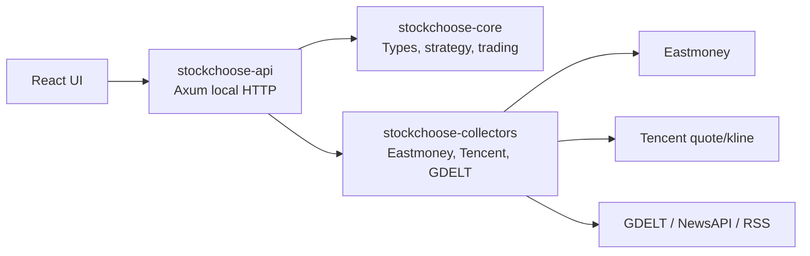

# STOCKCHOOSE Rust rewrite plan

## Context

STOCKCHOOSE is still a React/Vite/Electron workstation. The production data path has been consolidated around the Rust sidecar:

- `electron/rust-api.cjs`: starts or connects to `stockchoose-api` and proxies all local data routes.
- `electron/main.cjs` and `vite.config.ts`: Rust-only local proxies for `/aktools`, `/tencent-quote`, `/tencent-kline`, and `/gdelt-news` compatibility routes.
- `src/openDataService.ts`: AKShare/AKTools market and financial statement normalization into `Stock.metrics`.
- `src/realMarketDataService.ts`: Tencent quote/kline sync and full A-share candidate scan.
- `src/newsSourceServices.ts` and `src/newsPageServices.ts`: GDELT/NewsAPI/RSS/custom REST source configuration and news fetch.
- `src/strategyEngine.ts`: strategy filters, rank scoring, daily/realtime selection, ranking, and backtest.
- `src/tradingServices.ts`: manual/auto plan generation, paper fills, and CSV/client export.

The TypeScript/Electron browser-side collectors and JS data adapter fallbacks have been removed. Remaining TypeScript code is UI state, request orchestration, normalization for imported rows, and presentation logic.

## Target Containers

## Rust Workspace

- `crates/stockchoose-core`: shared data types, strategy screening, ranking, and trade plan generation.
- `crates/stockchoose-collectors`: real data collectors and AKTools-compatible row mapping.
- `crates/stockchoose-api`: local HTTP server that can run beside the existing Vite/Electron app first, then replace Node proxy logic.
- `electron/rust-api.cjs`: sidecar bridge that starts/proxies to the Rust API. If Rust is unavailable, data routes return explicit proxy failures instead of using JS collector fallbacks.

## API Contract

Current Rust API endpoints:

- `GET /health`
- `GET /aktools/{endpoint}` for AKTools-compatible local compatibility.
- `POST /api/integration/source-test`
- `POST /api/integration/aktools/rows`
- `POST /api/integration/asharehub/rows`
- `GET /api/data/stock-universe`
- `GET /api/market/ashare/spot`
- `GET /api/market/north-holdings`
- `GET /api/market/technical-indicators`
- `GET /api/market/tencent/quote`
- `GET /api/market/tencent/quote-rows`
- `GET /api/market/tencent/ashare/quotes`
- `GET /api/market/tencent/kline`
- `GET /api/market/tencent/kline-points`
- `GET /api/market/stock/{code}/kline?start_date=YYYYMMDD&end_date=YYYYMMDD`
- `GET /api/market/stock/{code}/kline-points`
- `GET /api/finance/statements/{date}`
- `GET /api/finance/metrics/{date}`
- `GET /api/finance/analyst-forecasts`
- `GET /api/finance/margin-balances`
- `POST /api/finance/annual-reports`
- `POST /api/filing/announcements`
- `GET /api/news/gdelt?query=...&max_records=...`
- `POST /api/news/articles`
- `POST /api/news/source-test`
- `POST /api/sentiment/events`
- `POST /api/sentiment/analysis`
- `POST /api/news-analysis/local-test`
- `POST /api/news-analysis/model-test`
- `POST /api/strategy/screen`
- `POST /api/strategy/rank`
- `POST /api/strategy/backtest`
- `POST /api/strategy/optimize`
- `POST /api/valuation/rows`
- `POST /api/trade/plan`
- `POST /api/trade/export`
- `POST /api/trade/paper/submit`
- `POST /api/trade/assets/sync`

## Migration Invariants

- Data collectors must return real remote rows or explicit failures; no local sample fallback may be used as proof of success.
- AKTools-compatible endpoints must keep the Chinese field names consumed by `openDataService.ts`.
- Daily/realtime selection must apply pool filters, enabled filters, scoped rank conditions, `poolLimit`, and `maxHoldings` weight limits.
- Strategy screening, ranking, backtest, and optimization rows must be returned by `/api/strategy/screen`, `/api/strategy/rank`, `/api/strategy/backtest`, and `/api/strategy/optimize`; browser-side strategy builders are compatibility stubs only, and App user paths must show an explicit failure instead of falling back to local strategy results.
- `/api/strategy/backtest` and `/api/strategy/optimize` must prefer Rust-collected Tencent daily K-line close prices for selected holdings and supported benchmarks such as HS300/CSI500; the deterministic model backtest may only remain a fallback when real K-line data is unavailable.
- Trading export must remain client-copyable with one order per line: `code<TAB>side<TAB>price<TAB>shares`.
- Trading status CSV and client-copy text must be rendered by `/api/trade/export`, not browser-side CSV/string builders.
- Executable trade plans must be created by `/api/trade/plan`; the legacy browser `createTradePlan` helper is a compatibility stub and must not synthesize executable orders.
- Manual trade asset sync must be validated and timestamped by `/api/trade/assets/sync`; the browser may keep local draft state but must not mark a manual edit as synced without a Rust response.
- Trade logs and trade history may display paper fills returned by `/api/trade/paper/submit` and Rust-confirmed asset sync records only; fixed demo timestamps or local sample fills must render as empty states instead.
- Valuation must only run when required real market and financial statement metrics exist.
- Valuation rows must be returned by `/api/valuation/rows`; the browser may check missing real fields and render summaries, but must not synthesize valuation rows locally.
- Annual report source downloads must use `sourceCsv` returned by `/api/finance/annual-reports`; the browser must not synthesize source files when Rust omits them.
- Sentiment events, linked stocks, recommendations, and insight reports must be returned by `/api/sentiment/events` and `/api/sentiment/analysis`; browser-side sentiment builders are compatibility stubs only.

## Verification Gates

1. Run `npm.cmd run rust:fmt`.
2. Run `npm.cmd run rust:test`.
3. Run `npm.cmd run rust:build`.
4. Run `npm.cmd run test:unit`.
5. Run `npm.cmd run build`.
6. Run `npm.cmd run test:smoke`.
7. Run `npm.cmd run rust:live-smoke -- --timeout-ms 30000` to probe live Rust collectors and Rust-backed user workflows. The script now covers source tests, market quotes/K-line, financial metrics, annual report real fetch, valuation real-data enrichment, filing announcements, news fetch/source contracts, news source test, sentiment event generation, sentiment linked-stock analysis, news analysis local/model tests, daily strategy selection, ranking, real-K-line backtest/optimization, trade plan/export, paper submit, and manual asset sync. Set `ASHAREHUB_API_KEY` to include AShareHub and add `--include-slow` to include the full Tencent all-A-share quote scan. For final completion audit, add `--strict-source` so provider-specific probes fail when they only return rows through a real-source fallback.
8. Verify a live sidecar route returns `x-stockchoose-data-engine: rust`, for example `POST /api/integration/aktools/rows` with `baseUrl: "/aktools/api/public"` and endpoint `stock_zh_a_spot`.
9. Probe live Rust data routes for row-bearing responses: Tencent quote rows, Tencent all-A-share quotes, Eastmoney financial metrics, AShareHub proxy rows when a key is configured, filing announcements, and GDELT/news fetch.

## Current Routing

`/aktools` is now Rust-only:

1. Electron/Vite calls `electron/rust-api.cjs`.
2. The bridge uses `STOCKCHOOSE_RUST_API_URL` when provided, or starts a local sidecar from `target/release`, `target/debug`, or packaged resources.
3. If Rust is healthy, the request is proxied to `stockchoose-api` and responses include `x-stockchoose-data-engine: rust`.
4. If Rust is missing or unhealthy, the Electron/Vite proxy responds with an explicit 502-style failure. No JS Eastmoney adapter or browser-side remote parser is used.

Legacy compatibility routes are also Rust-only:

- `/tencent-quote` rewrites to `/api/market/tencent/quote`.
- `/tencent-kline` rewrites to `/api/market/tencent/kline`.
- `/gdelt-news` rewrites to `/api/news/gdelt`.

AShareHub integration is Rust-proxied through `POST /api/integration/asharehub/rows`. The browser passes saved source settings to the local API, and the Rust sidecar sends `X-API-Key` to AShareHub for whitelisted market, financial, margin, northbound, and reference endpoints.

GDELT integration normalizes query terms that contain `-`, retries transient `429`/`5 second` limit responses with bounded backoff, and caches successful GDELT payloads briefly inside the sidecar so a source-contract check does not immediately duplicate the same upstream request.

## Remaining Work

- Continue pruning stale UI labels that imply local sample data while keeping explicit failure messaging where real data is unavailable.
- Keep strengthening live-source coverage for any newly added user-facing data workflow.
- Use `scripts/rust-live-smoke.mjs` as the repeatable live collector audit before claiming real data coverage. A `WARN` result means the route returned rows through another real source; it is acceptable for daily diagnostics but not enough to prove the named provider itself is healthy.
- The rewrite is not considered complete until all user-facing data and collection workflows are verified through Rust routes with no browser-side collector fallback.
