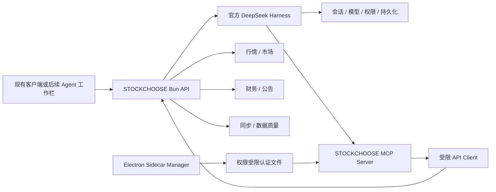

# STOCKCHOOSE Agent 智能化工作台实施规划

**状态：** Backend foundation implemented

**日期：** 2026-09-25

**参考实现：** `zuohuadong/volt-gui` 的 `origin/dev`，核对提交 `08a09f86109d5e92d65a848bd712fc0ef8dc0146`

**本阶段硬边界：** 不修改 React 页面、样式、路由和交互

## 1. 当前决策

STOCKCHOOSE 不再建设自己的 Agent 编排器。系统采用与 Volt GUI `dev` 分支一致的单运行时边界：

1. 官方 DeepSeek Harness（DSH）拥有会话、模型、权限、Agent 状态和持久化。
2. STOCKCHOOSE Bun sidecar 继续拥有行情、财务、公告、同步和其他股票领域事实。
3. MCP 将 Bun 领域能力以只读白名单工具提供给官方 DSH。
4. Bun 只提供 DSH 网关和领域 API，不实现第二套 Planner、RunStore、模型配置或审批状态机。
5. Electron 继续保护 Bun sidecar 实例 token；DSH 通过权限受限的认证文件读取 token。
6. 首期 Agent 只能研究和解释，不提交纸面交易或真实交易。

对应架构决策见 `docs/architecture/adr/0002-agent-workbench-official-dsh-runtime.md`。

## 2. 架构边界

### 官方 DSH 负责

- 会话创建、历史、取消和运行状态。
- 模型供应商与凭据。
- Prompt 执行、工具选择和权限策略。
- MCP 生命周期和工具协议。
- Agent 会话持久化。

### STOCKCHOOSE 负责

- 股票领域 API 和真实数据契约。
- Agent 请求的股票上下文注入。
- 只读 MCP 工具和输入上限。
- Bun sidecar 的认证、限流、响应大小和出站安全。
- 将官方 DSH RPC/事件转换为稳定的 `/api/agent/*` 接口。

### 明确不建设

- Bun `AgentOrchestrator`、`Planner` 或 `RunStore`。
- 第二套会话、模型凭据或 Agent 状态数据库。
- 模型任意 HTTP、SQL、文件或代码执行工具。
- Agent 交易提交工具。

## 3. 已完成的后端基础

### 3.1 官方 DSH 网关

`bun-api/agent/dshGateway.ts` 已实现：

- 只接受 `http://127.0.0.1:<port>/?token=<43 chars>` 启动地址。
- 使用官方 DSH 的 Cookie 认证和 RPC 响应关联。
- 支持会话列表、创建、提问、取消和历史快照。
- 使用 WebSocket `session/follow` 获取持久化事件和正在输出的 assistant stream。
- 对请求、流和认证设置超时，并在认证失效时清理状态。

### 3.2 Agent API

已注册以下 Bun API：

| 方法 | 路径 | 用途 |
|---|---|---|
| `GET` | `/api/agent/status` | 查看 DSH 配置和连接状态；`probe=1` 可主动探测 |
| `GET` | `/api/agent/sessions` | 查询官方 DSH 会话 |
| `POST` | `/api/agent/sessions` | 在 STOCKCHOOSE 工作区创建会话 |
| `GET` | `/api/agent/sessions/:id/history` | 获取会话历史和流式快照 |
| `POST` | `/api/agent/sessions/:id/prompt` | 发送带股票研究约束和冻结上下文的请求 |
| `POST` | `/api/agent/sessions/:id/cancel` | 取消当前会话执行 |

Prompt 会强制要求：

- 优先使用 `stockchoose_*` 白名单工具。
- 区分事实、推断和建议。
- 数据不足时明确说明，不补造当前行情。
- 禁止提交纸面或真实交易。

### 3.3 MCP 股票工具

`scripts/stockchoose-agent-mcp.mjs` 已提供：

| 工具 | 数据能力 | 权限 |
|---|---|---|
| `stockchoose_sync_status` | 同步状态、最近运行、缓存和数据源健康 | 只读 |
| `stockchoose_market_overview` | A 股市场概览 | 只读 |
| `stockchoose_market_quotes` | 最多 50 只股票的真实行情 | 只读 |
| `stockchoose_stock_profile` | 公司资料和行业信息 | 只读 |
| `stockchoose_finance_statements` | 财务报表 | 只读 |
| `stockchoose_filing_announcements` | 最多 20 只股票、50 条公告 | 只读 |

所有工具只访问 loopback Bun API，携带 sidecar 实例 token，限制输入数量和最大响应，并对上游错误中的敏感字段脱敏。

### 3.4 DSH Profile Overlay

`agent/stockchoose-dsh-profile.yml` 使用官方 `@deepseek-ai/dsh-mcp-client` 注册 STOCKCHOOSE stdio MCP Server。它只向 MCP 进程传入：

- `STOCKCHOOSE_BUN_API_URL`
- `STOCKCHOOSE_AGENT_AUTH_FILE`

不把 sidecar token 直接写入 profile、命令参数或 DSH 环境变量。

### 3.5 Electron/Bun 认证桥

- Electron 启动 Bun sidecar 前生成随机实例 token。
- token 原子写入 `data-cache/agent-runtime/sidecar-auth`。
- 文件按当前平台能力设置为仅当前用户可读写。
- MCP 在每次启动时从文件读取 token。
- sidecar 停止时删除认证文件。

此设计兼容 Volt GUI 对 DSH 子进程环境的清理规则：包含 `token`、`secret` 或 `apiKey` 的环境变量不会被继承，但不含秘密值的认证文件路径可以继承。

## 4. 本阶段验收

- Agent API 未配置 DSH 时返回可诊断状态，不影响现有股票功能。
- DSH 启动地址必须是带唯一 token 的 IPv4 loopback HTTP URL。
- MCP 只能访问无凭据的 loopback STOCKCHOOSE API URL。
- 非法股票代码、超量代码和超大响应被拒绝。
- Agent Prompt 绑定当前股票/策略/数据快照时进行长度和格式限制。
- 前端文件无本阶段改动。
- `npm run test:agent`、Electron sidecar 测试、Bun 构建检查、前端单元测试和生产构建通过。

## 5. 后续阶段

### Phase 1：官方 DSH 生命周期与安装包

在 Electron 主进程中实现 Volt GUI 同类的受管生命周期：

- 精确锁定官方 `@deepseek-ai/dsh` 和 Node 26 runtime。
- 启动 `dsh web`，绑定 `127.0.0.1` 随机端口并应用 STOCKCHOOSE profile。
- 从标准输出提取并校验唯一可信启动 URL。
- 失败时提供有限重试、诊断摘要和退出清理。
- staging 和 electron-builder 只打包一个官方 DSH 运行时。
- 增加 staged/package smoke，验证 MCP 脚本和原生依赖路径。

在此阶段完成前，DSH 仍是外部可选运行时，通过 `STOCKCHOOSE_DSH_START_URL` 连接。

### Phase 2：右侧 Agent 工作栏

仅在用户确认进入前端阶段后实施：

- 在现有应用壳层右侧挂载可收起/展开工作栏。
- 不增加一级导航，不改现有专业页面的信息架构。
- 展开态消费 `/api/agent/*`，收起时不停止 DSH 会话。
- 页面仅传递当前股票、策略、股票池和数据快照上下文。
- 会话、权限、模型配置和历史仍由官方 DSH 管理。

该阶段不得重新引入 renderer 自有 Agent 状态机或持久化。

### Phase 3：扩大只读研究工具

- 新闻和舆情检索。
- 策略筛选、排名和规则回测。
- 价值核算与结构化研究报告。
- 工具级数据新鲜度、来源和证据字段。

写入股票池、策略或交易计划必须另立权限和审批设计，不随只读工具自动开放。

## 6. 当前限制

1. 官方 DSH 尚未由 STOCKCHOOSE Electron 自动启动。
2. Node 26 和官方 DSH 尚未进入 STOCKCHOOSE 安装包。
3. 当前没有 Agent 前端入口，符合本阶段“不改变前端”的要求。
4. 当前工具只覆盖同步、市场、行情、公司资料、财务和公告。
5. 官方 DSH 与 STOCKCHOOSE 的端到端联调需要外部 DSH runtime 和模型凭据。
6. DSH RPC 属于外部运行时契约；升级官方包时必须运行集成测试并核对 endpoint/schema。

## 7. 回滚

Agent 是附加后端能力。回滚时可以：

1. 不设置 `STOCKCHOOSE_DSH_START_URL`，现有功能继续运行。
2. 移除 DSH profile 中的 STOCKCHOOSE MCP 插入项。
3. 停止暴露 `/api/agent/*` 路由，不影响现有业务 API。
4. 保留 Bun sidecar token 机制，避免影响 Electron 对现有数据 API 的认证。
