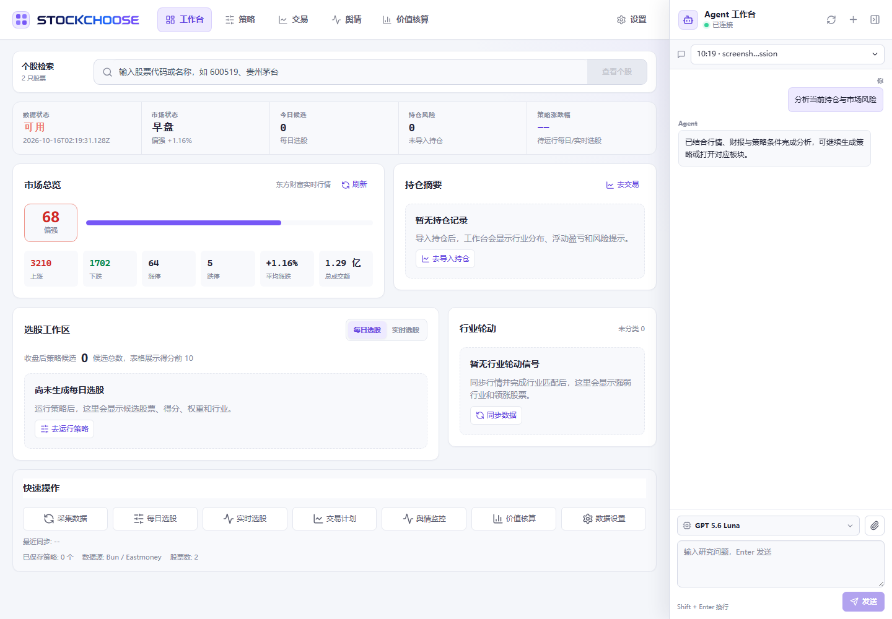
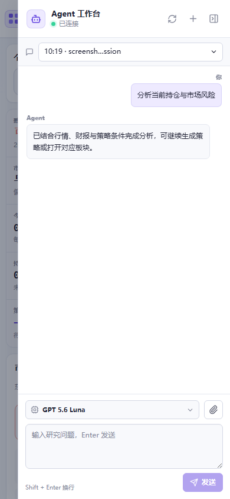
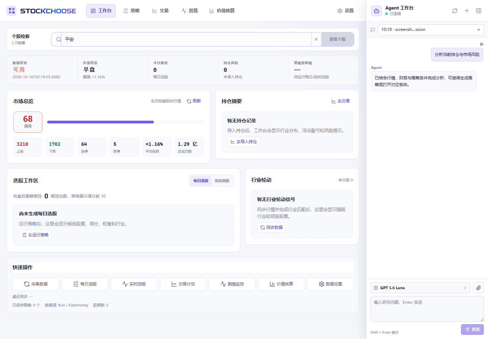
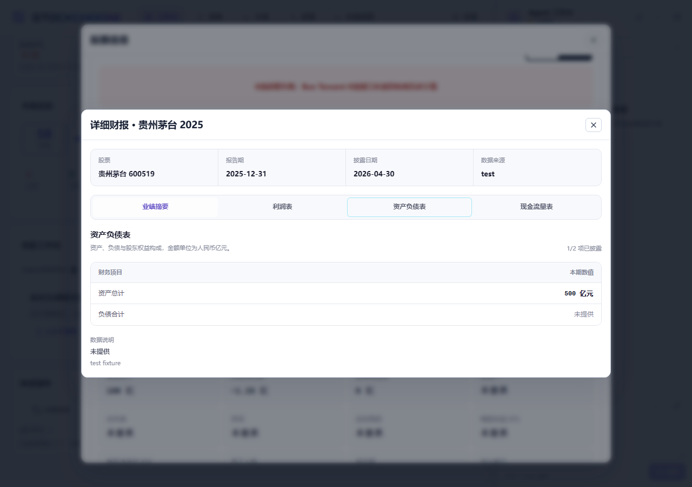
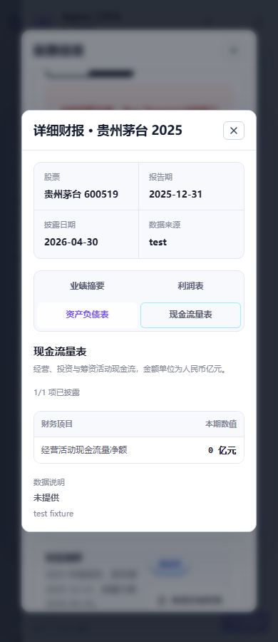
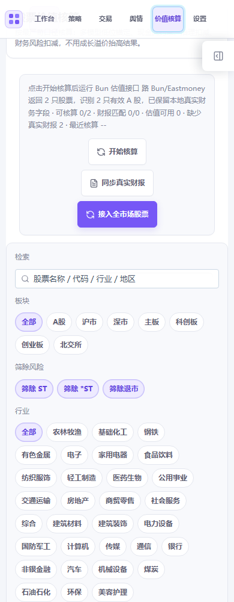

# 项目截图

更新时间：2026-10-16

本目录只保留当前版本的代表性截图。截图由本地 Playwright 使用固定测试数据生成，用于展示界面与响应式布局，不代表实时行情。

| 场景 | 视口 | 文件 |
| --- | --- | --- |
| Agent 工作台 | 1440 × 1000 | [agent-workbench-desktop.png](current/agent-workbench-desktop.png) |
| Agent 移动端抽屉 | 390 × 844 | [agent-workbench-mobile.png](current/agent-workbench-mobile.png) |
| 股票搜索 | 1440 × 1000 | [stock-search-desktop.png](current/stock-search-desktop.png) |
| 详细财报 | 1280 × 900 | [financial-report-desktop.png](current/financial-report-desktop.png) |
| 详细财报移动端 | 390 × 900 | [financial-report-mobile.png](current/financial-report-mobile.png) |
| 价值核算行业选择 | 390 × 1000 | [valuation-industries-mobile.png](current/valuation-industries-mobile.png) |

## 预览

### Agent 工作台

### 股票搜索

### 财报详情

### 价值核算

## 维护规则

- 新截图验证无错位、遮挡和横向溢出后，直接替换 `current/` 中的同名文件。
- 不提交 `tmp/`、`output/`、`test-results/` 或 `playwright-report/` 中的过程截图。
- 品牌图标与应用资源继续保存在 `public/brand/` 和 `electron/`，不归入截图目录。
